안녕하세요, 김도겸입니다.  
사내 PMS 개선 과정에서 Hiworks API 연동이 필요한 기능들을 사전 조사하여 정리한 기술 가이드입니다. 추후 연동 작업을 진행할 때 참고 자료로 활용하실 수 있도록 핵심 내용을 정리했습니다.

## 1. Hiworks API 인증 체계 현황 및 기존 외부 API와의 차이점

Google, Kakao 등 일반적인 외부 서비스 API를 연동할 때와 비교하면, 현재 Hiworks API는 **OAuth 2.0 기반의 사용자 토큰 체계가 전면 미지원** 상태이므로 설계 단계부터 접근 방식을 다르게 가져가야 합니다.

### 1.1. 미지원 범위 (사용 불가)

기존 OAuth 2.0 표준 흐름에 해당하는 아래 기능들은 현재 Hiworks API에서 지원하지 않습니다.

- **OAuth 2.0 앱 등록 및 키 발급:** 개발자 센터를 통한 애플리케이션 등록, `Client ID` / `Client Secret` 발급, `Redirect URI` 등록
- **사용자별 토큰 발급 및 자동 갱신:** `Authorization Code` 교환, 개별 사용자 단위 `Access Token` 발급, `Refresh Token`을 이용한 자동 갱신(Refresh)
- **외부 서비스 주도 간편 로그인:** 사내 시스템 로그인 화면 내 `[하이웍스로 로그인]` 버튼 구현 및 사용자 토큰 기반 API 호출

### 1.2. 현재 지원되는 토큰 체계 (대체 수단)

`Access Token` / `Refresh Token` 대신, Hiworks는 **역할이 분리된 세 가지 토큰**으로 인증과 API 호출을 처리합니다.

| 구분                          | 발급 위치                                                | 성격 및 용도                                                                                                                                                    |
| :---------------------------- | :------------------------------------------------------- | :-------------------------------------------------------------------------------------------------------------------------------------------------------------- |
| **`Office Token`**            | 오피스 관리 `[서비스 연동 > 오피스 연동 > 서비스 연동]`  | 오피스(관리자) 단위의 고정 인증 키. 인사, 전자결재, 메신저 알림 등의 API 호출 시 **`Authorization: Bearer {office_token}` 헤더**에 사용                         |
| **`LinkAuth Token`**          | 오피스 관리 `[서비스 연동 > 오피스 연동 > 조직 연동]`    | 인사 정보(구성원, 조직, 직위, 직무) 관리용 인증 키. 관련 작업 API 호출 시 **`Authorization: Bearer {linkAuth_token}` 헤더**에 사용                              |
| **SSO 임시 토큰 (`{token}`)** | 인트라넷 메뉴 클릭 시 콜백 URL(`?token=...`)로 자동 전달 | 사용자 정보 조회용 일회성 티켓. API 호출 권한은 없으며, 백엔드가 `Office Token`으로 `GET /v4/tokens/{token}`을 호출해 사용자 식별 정보를 확인하는 용도로만 사용 |

### 1.3. 일반 외부 API(OAuth 2.0) 연동과의 핵심 차이점

| 비교 항목              | 일반 외부 API (OAuth 2.0 표준)                      | 현재 Hiworks API                                                                                              |
| :--------------------- | :-------------------------------------------------- | :------------------------------------------------------------------------------------------------------------ |
| **인증 토큰 단위**     | 사용자별 `Access Token` / `Refresh Token` 발급      | 오피스 전체 단위 고정 토큰(`Office Token` / `LinkAuth Token`) 사용                                            |
| **토큰 갱신 방식**     | 만료 시 `Refresh Token`으로 서버가 자동 재발급      | **자동 갱신 없음** (만료·변경 시 관리자가 오피스 관리에서 수동 재발급 후 환경 변수/SSM 교체)                  |
| **설정 및 관리 주체**  | 개발자 센터에서 앱 등록 및 검수 진행                | 하이웍스 오피스 전체 관리자 화면에서 URL·토큰 직접 등록                                                       |
| **로그인 진입 방향**   | 사내 시스템에서 로그인 버튼 클릭 (**SP-Initiated**) | 하이웍스 인트라넷 메뉴 클릭 후 콜백 진입 (**IdP-Initiated**)                                                  |
| **자체 세션·JWT 관리** | 외부 토큰 수명과 연동하거나 교환해 세션 유지        | `v4/tokens/{token}`으로 사용자만 확인한 뒤, 이후 인증·갱신은 **전부 사내 시스템 자체 JWT/세션으로 독립 관리** |

---

## 2. 연동 전 사전 준비 (하이웍스 오피스 관리 설정)

모든 사전 설정은 개발자 센터가 아닌 **하이웍스 오피스 전체 관리자 메뉴**에서 진행합니다.

> 오피스 전체 관리자 메뉴는 해당 권한을 가진 계정을 관리하시는 분께 협조 요청이 필요합니다.

### 2.1. `Office Token` 발급

#### 1) 하이웍스 관리 메뉴 진입

오피스 홈 화면에서 `[하이웍스 관리]` 메뉴를 클릭합니다.

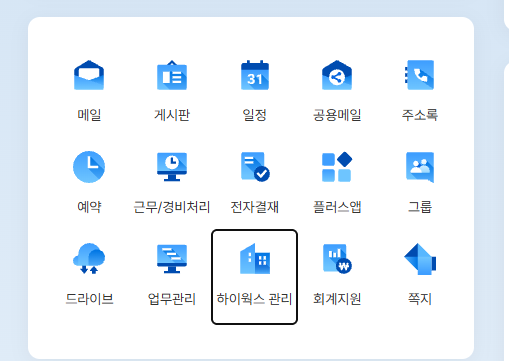

#### 2) 서비스 연동 추가 화면 이동

`[오피스 관리 > 서비스 연동 > 오피스 연동]` 메뉴로 이동한 뒤, `[서비스 연동 > + 서비스 연동 추가]`를 클릭합니다.

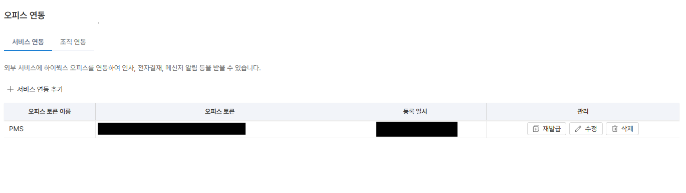

#### 3) 사용 범위 및 허용 IP 설정

추가 화면에서 사용 범위(Scope)를 선택한 뒤, 허용 IP를 입력하여 추가하고 저장합니다.

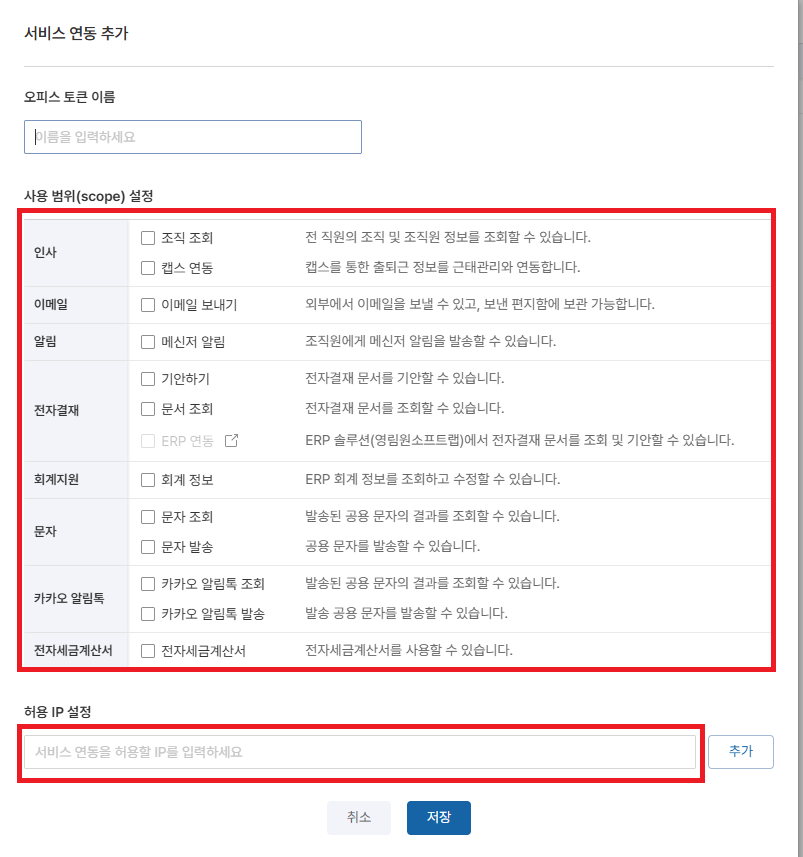

> 연동할 서버의 IP 주소와 테스트 환경의 IP 주소를 반드시 함께 설정해야 합니다.

- **보안 주의사항:** 발급된 토큰은 오피스 전체 권한에 영향을 미치므로 코드나 Git 저장소에 절대 커밋하지 않습니다.
- **보관 원칙:** 로컬 개발 환경은 `.env`, 스테이징·운영 환경은 **AWS SSM Parameter Store(`SecureString`)**에만 보관합니다.

### 2.2. `LinkAuth Token` 발급 (조직 연동용)

조직, 직위, 직무, 구성원 관리 등의 조직 연동 API를 사용해야 하는 경우 별도의 API Key를 발급받아야 합니다.

> Hiworks API 가이드에서는 해당 조직 연동용 API Key를 `linkAuth_token`으로 정의하고 있어, 혼동을 방지하고자 `LinkAuth Token`이라는 명칭으로 설명드리겠습니다.

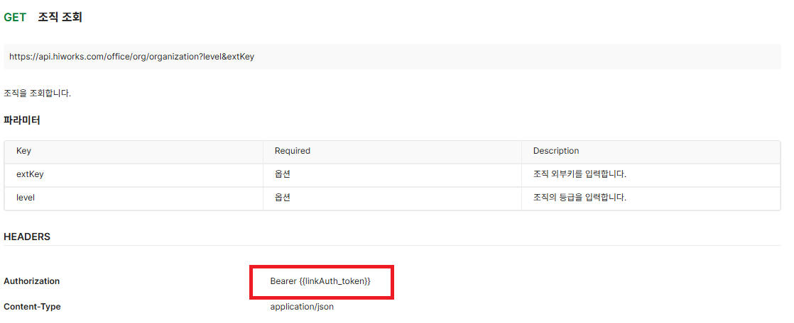

#### 1) 하이웍스 관리 메뉴 진입

오피스 홈 화면에서 `[하이웍스 관리]` 메뉴를 클릭합니다.


#### 2) 조직 연동 추가 화면 이동

`[오피스 관리 > 서비스 연동 > 오피스 연동]` 메뉴로 이동한 뒤, `[조직 연동 > + 조직 연동 추가]`를 클릭합니다.

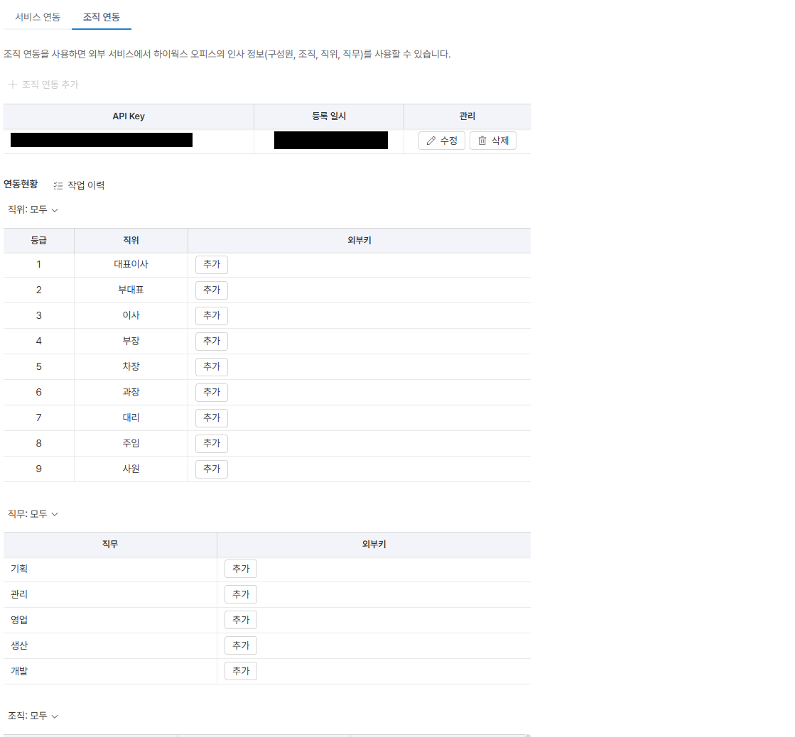

#### 3) 연동 범위 및 허용 IP 설정

추가 화면에서 연동 범위를 선택한 뒤, 연동 서버 허용 IP를 입력하여 추가하고 저장합니다.

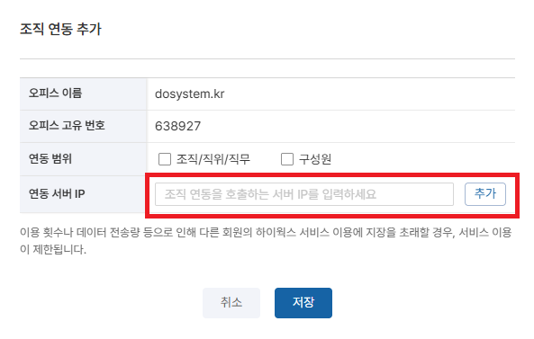

### 2.3. SSO 외부 연동 URL 등록 (로그인 연동 시)

#### 1) SSO 외부로 연동 메뉴 이동

`[오피스 관리 > 서비스 연동 > SSO 관리 > 외부로 연동]` 메뉴로 이동합니다.

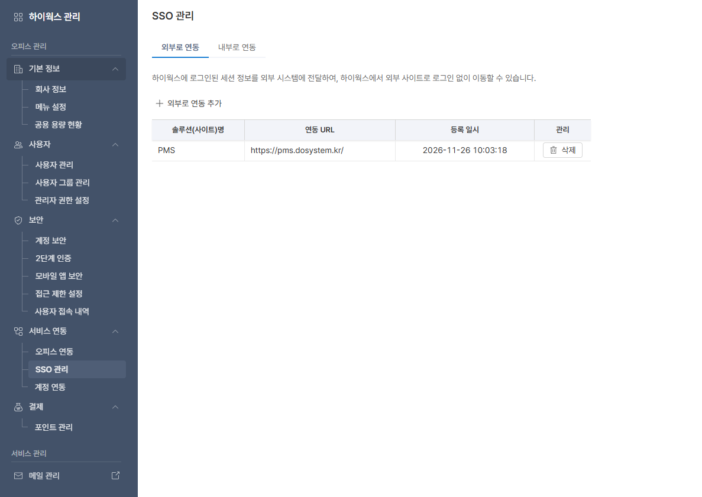

#### 2) 외부로 연동 정보 등록

`[+ 외부로 연동 추가]`를 클릭한 뒤 솔루션명과 연동 URL 정보를 입력하여 등록합니다.

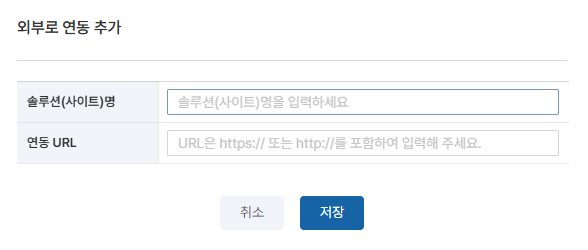

> 토큰 탈취 방지를 위해 연동 URL은 반드시 `https://` 프로토콜로 등록합니다.

#### 3) 바로 가기 메뉴 설정 이동

`[오피스 관리 > 기본 정보 > 메뉴 설정 > 바로 가기 메뉴 설정]` 메뉴로 이동합니다.

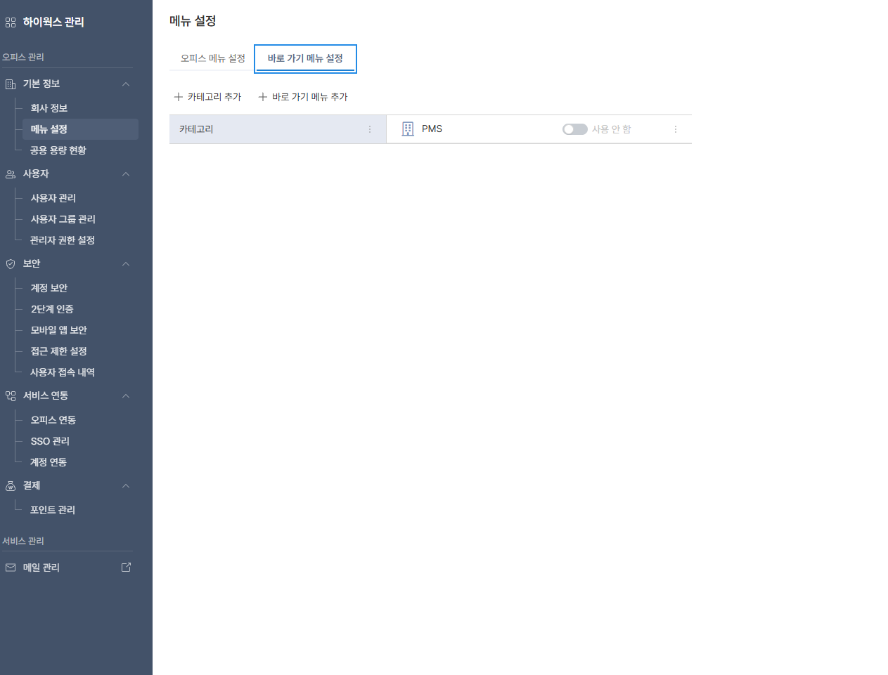

#### 4) 바로 가기 메뉴에 SSO 항목 연결

`[+ 바로 가기 메뉴 추가]`를 클릭한 뒤, 앞서 생성한 SSO 항목을 선택하여 저장합니다.

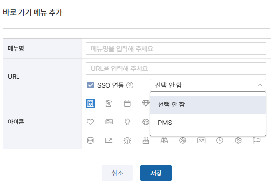

#### 5) 메뉴 정상 노출 확인

오피스 홈 화면에서 등록한 바로 가기 메뉴가 정상적으로 노출되는지 확인합니다.

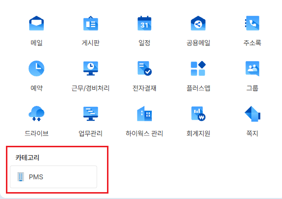

---

## 3. API 공통 호출 방법 (`Office Token` 기반)

Hiworks API는 `GET` 요청이더라도 **`Authorization: Bearer {office_token}` 헤더**를 필수로 포함해야 합니다. 프론트엔드(브라우저)에서 직접 호출하면 CORS 정책에 차단되고 `Office Token`이 외부에 노출되므로, **반드시 백엔드 서버 간 통신(Server-to-Server)**으로 호출합니다.

> PMS 개선 사항 중 조직도 조회 기능이 필요하니 해당 API를 기준으로 설명드리도록 하겠습니다.

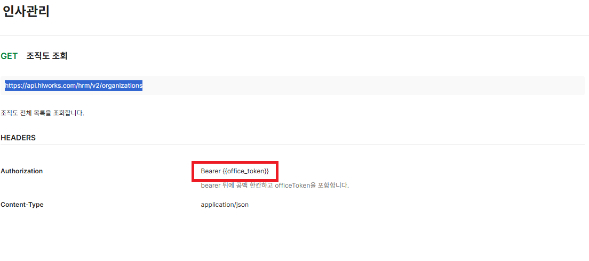

### Postman 설정 기준

- **Method / URL:** `GET` / `https://api.hiworks.com/hrm/v2/organizations`
- **Authorization 탭:** Type을 `Bearer Token`으로 선택 후 Token 란에 `Office Token` 입력 _(또는 Headers 탭에 `Authorization: Bearer {office_token}` 직접 입력)_

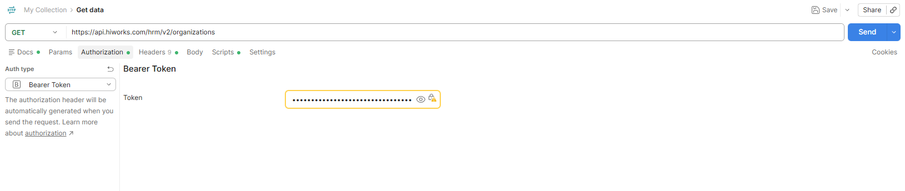

### Spring Boot (`RestClient`) 호출 예시

```java
@Service
@RequiredArgsConstructor
public class HiworksOrganizationService {

    @Value("${hiworks.url.organizations}")
    private String organizationsUrl;

    @Value("${hiworks.office.token}")
    private String officeToken;

    private final RestClient restClient = RestClient.create();

    public List<HiworksOrganizationModel> getAllOrganizationList() {
        HiworksOrganizationModel[] response = restClient.get()
                .uri(organizationsUrl)
                .header(HttpHeaders.AUTHORIZATION, "Bearer " + officeToken)
                .accept(MediaType.APPLICATION_JSON)
                .retrieve()
                .body(HiworksOrganizationModel[].class);

        return response != null ? Arrays.asList(response) : Collections.emptyList();
    }
}
```

- **응답값 예시**
  응답값 예시는 아래와 같습니다.

  ```json
  {
    "node_id": "12312",
    "name": "하이웍스",
    "entries": [
      {
        "is_admin": "Y",
        "is_construction_admin": "N",
        "mail_id": "admin",
        "name": "홍길동",
        "email": "",
        "phone": "",
        "cell": "",
        "node_id": "12312",
        "user_no": "1232345"
      },
      {
        "is_admin": "N",
        "is_construction_admin": "N",
        "mail_id": "kcs",
        "name": "김철수",
        "email": "",
        "phone": "",
        "cell": "",
        "node_id": "12312",
        "user_no": "2343456"
      },
      {
        "is_admin": "N",
        "is_construction_admin": "N",
        "mail_id": "kyh",
        "name": "김영희",
        "email": "",
        "phone": "",
        "cell": "",
        "node_id": "12312",
        "user_no": "3454567"
      }
    ],
    "nodes": [
      {
        "node_id": "23434",
        "name": "하이웍스 마케팅",
        "parent_no": "12312",
        "entries": [
          {
            "is_admin": "N",
            "is_construction_admin": "N",
            "mail_id": "kkd",
            "name": "김길동",
            "email": "",
            "phone": "",
            "cell": "",
            "node_id": "23434",
            "user_no": "4565678"
          },
          {
            "is_admin": "N",
            "is_construction_admin": "N",
            "mail_id": "khs",
            "name": "김희선",
            "email": "",
            "phone": "",
            "cell": "",
            "node_id": "23434",
            "user_no": "5676789"
          }
        ]
      }
    ]
  }
  ```

> LinkAuth Token을 사용하는 API에서도 호출 방식은 거의 동일합니다.

---

## 4. SSO 외부 연동 구현 가이드 (IdP-Initiated)

사용자가 하이웍스 인트라넷 메뉴를 클릭하면 등록된 콜백 URL로 `https://{service-url}?token={token}` 형태의 리다이렉트 요청이 들어옵니다. 백엔드는 이 토큰을 하이웍스 서버에 역조회해 진위를 검증한 뒤 자체 로그인 세션을 발급합니다.

### 대표적인 전체 인증 흐름

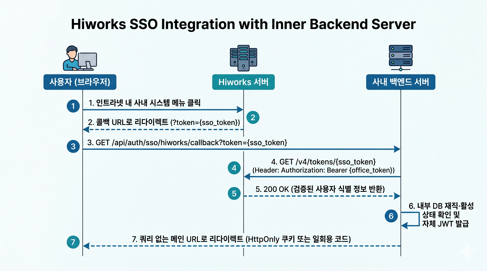

### 구현 시 필수 보안 체크포인트

`GET` 쿼리 파라미터로 임시 토큰이 전달되는 특성상 아래 3가지 방어 로직을 함께 적용해야 합니다.

1. **콜백 처리 후 즉시 리다이렉트 및 Referrer 차단**
   - 검증 및 자체 JWT 발급(또는 30초 유효 일회용 교환 코드 발급)을 마치면 주소창에 `?token=...`이 남지 않도록 쿼리 파라미터가 없는 깨끗한 URL로 즉시 리다이렉트합니다.
   - 응답 헤더에 `Referrer-Policy: no-referrer`를 적용해 외부 리소스로 토큰 URL이 유출되는 것을 막습니다.
2. **액세스 로그 마스킹**
   - Nginx, ALB, Spring 액세스 로그에 `?token=...` 원문이 평문으로 기록되지 않도록 쿼리 스트링 마스킹 설정을 적용합니다.
3. **내부 계정 상태 이중 검증**
   - 하이웍스 검증 API에서 정상 응답이 오더라도, 사내 DB에서 등록 여부와 퇴사·비활성 상태를 한 번 더 확인한 뒤 자체 인증을 완료합니다.

---

## 마무리

금주 업무를 진행하며 주요 하이웍스 연동 기능들을 조사해 보았습니다. 추후 하이웍스 연동을 구현하실 때 시행착오를 줄이는 데 조금이나마 도움이 되었으면 합니다.

설명드린 기능 외 다른 API의 세부 내용은 [Hiworks API 문서](https://documenter.getpostman.com/view/6863253/S1TVWcri#3c2d5787-2c31-4ebc-8040-72987557c35e)에서 확인하실 수 있습니다.  
(추후 다른 기능 요건이 추가로 검토될 경우, 본 문서에 내용을 보강하도록 하겠습니다.)

감사합니다.
