## 1. 인트로

안녕하세요 이호균입니다. 이번에 신입 멘토링 프로젝트를 진행하며 학습한 @Transactional에 대한 내용을 정리했습니다.

## 2. 트랜잭션

트랜잭션이란 한 번에 수행되어야 할 작업의 단위이다.

예를들어 A가 B에게 돈을 송금한다고 할때

1. A 계좌에서 5만원 출금
2. B 계좌에 5만원 입금

이 2개의 작업은 반드시 함께 성공하거나 함께 실패되어야 한다.

만약 출금은 성공했는데 입금이 실패했다면 5만원은 세상에서 아예 사라지게 된다.

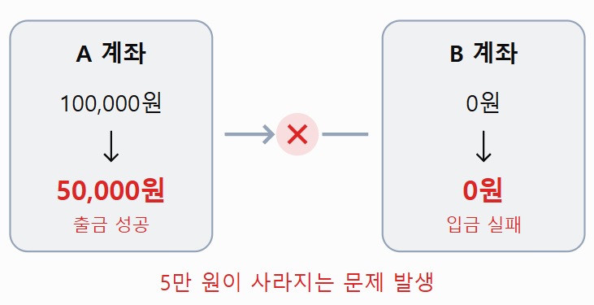

따라서 입금 작업이 실패했다면 그 전에 성공했던 출금 작업도 취소시켜야 A가 억울하게 돈을 잃지 않을 수 있다.

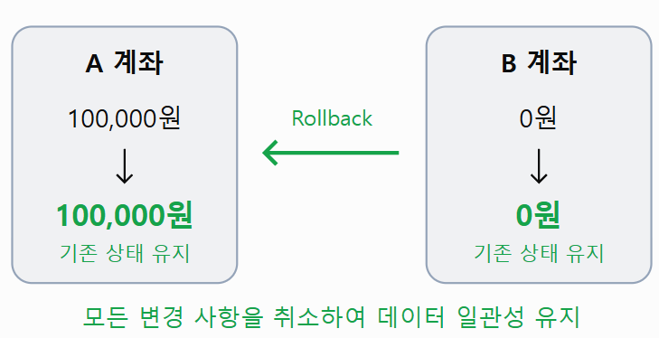

## 3. @Transactional

그리고 이러한 트랜잭션 기능을 스프링에서는 어노테이션으로 제공하여 개발자가 쉽게 사용할 수 있다.

현재 진행 중인 프로젝트의 게시글 수정(updatePost) 메서드를 통해 트랜잭션이 어떻게 동작하는지 로그로 알아보자.

```java
    // 게시글 수정
    @Override
    @Transactional
    public PostUpdateResponse updatePost(PostUpdateRequest request, Long postId, Long memberId) {

        // 1. 회원 조회 => select 쿼리
        validateMember(memberId);

        // 2. 게시글 조회 => select 쿼리
        Post post = validatePostOwner(postId, memberId);

        // 3. post 객체 내부 값 변경
        post.updateContent(request.getTitle(), request.getContent());

        // 4. flush 호출 -> 더티 체킹 -> update 쿼리
        postRepository.flush();
        
        PostUpdateResponse response = new PostUpdateResponse(post.getId(), post.getTitle(), post.getContent(), post.getUpdatedAt(), "게시글이 수정되었습니다.");
        
        // 5. 메서드 종료 -> commit
        return response;
    }
```

### (1) 트랜잭션 생성

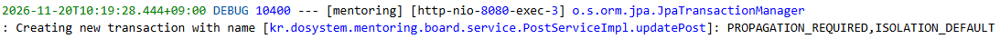

@Transactional이 붙어있는 updatePost 메서드를 호출하면 트랜잭션이 시작된다.

| 로그 | 설명 |
|---|---|
| Creating new transaction | 새로운 트랜잭션 생성 |
| PostServiceImpl.updatePost | 트랜잭션이 적용되는 메서드 |
| PROPAGATION_REQUIRED (기본값) | 트랜잭션 전파 속성 |
| ISOLATION_DEFAULT (기본값) | 트랜잭션 격리 수준 |

### (2) 회원 조회 select

- validateMember(memberId) 메서드 호출 시

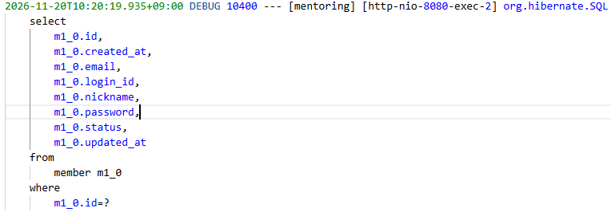

### (3) 게시글 조회 select

- validatePostOwner(postId, memberId) 메서드 호출 시

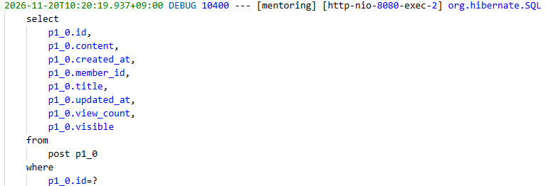

이 로그를 통해 회원과 게시글의 findById 메서드가 호출되어, 각각 select 쿼리가 실행되는 것을 확인할 수 있다.

### (4) flush 호출

- postRepository.flush() 호출 시

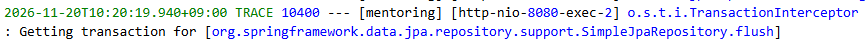

flush()를 호출하면 이후에 실제 update 쿼리를 실행하고 db에 반영한다. 다만 아직 이 시점에선 commit된 것이 아니기 때문에 언제든 rollback이 가능하다.

- (참고) 여기서 flush를 사용한 이유: 어차피 JPA의 더티 체킹 기능으로 인해 flush를 호출하지 않아도 자동으로 update 되지만 response body에 updatedAt 필드가 있어서 갱신된 최신 updatedAt 값을 전달하기 위해 사용함.

### (5) 게시글 수정 update

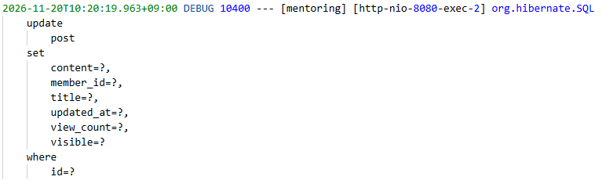

update는 더티 체킹 기능으로 자동으로 실행된다.

### (6) flush 종료

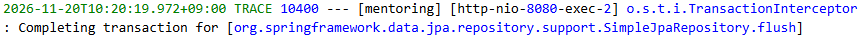

### (7) 트랜잭션 종료

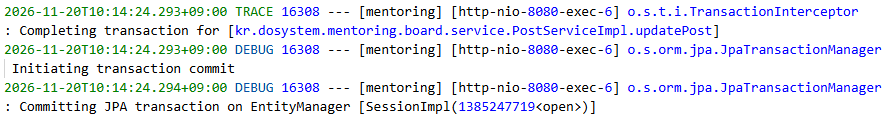

마지막으로 return을 통해 updatePost 메서드가 정상 종료되면 이때 최종적으로 commit이 수행되어 트랜잭션이 종료된다.

이처럼 게시글 수정 메서드의 여러 쿼리들이 하나의 트랜잭션 단위로 동작하는 것을 확인할 수 있다.

또한 @Transactional을 사용하지 않고 사용자가 직접 try ~ catch 문을 통해 트랜잭션을 관리할 수 있지만, 개발의 편리함을 위해서는 사용하는게 좋다.

## 4. @Transactional의 readOnly 속성

@Transactional의 속성에는 총 12가지가 있지만 프로젝트에서 사용했던 readOnly 옵션에 대해서만 살펴보겠습니다.

### (1) readOnly

readOnly는 트랜잭션에서 데이터를 조회만 한다고 명시하는 속성이다. 기본값은 false이며, true로 설정하면 조회 속도를 높일 수 있다. 따라서 서비스 클래스의 CRUD 메서드 중 읽기 메서드에 대해서만 readOnly = true로 설정한다.

또한 @Transactional을 클래스에 붙일 수도 있지만 메서드마다 필요한 트랜잭션 설정이 다르기 때문에 메서드에 붙이는게 더 좋다.

### (2) readOnly = true 일때 속도가 높아지는 이유

readOnly = true인 경우, 하이버네이트의 FlushMode가 MANUAL로 변경되어 flush 메서드를 생략하기 때문이다. 이로 인해 더티 체킹 또한 생략되고 JPA의 영속성 컨텍스트에서 스냅샷을 보관하지 않아 성능향상이 이루어지게 된다.

즉, 여러 작업들이 생략되어 최종적으로 조회 속도가 더 빨라지게 된다.

### (3) FlushMode

| FlushMode | 설명 |
|---|---|
| AUTO(기본값) | commit 또는 필요한 쿼리 실행 전에 자동 Flush |
| COMMIT | commit 시점에 Flush |
| ALWAYS | 쿼리를 실행하기 전에 Flush |
| MANUAL | flush() 직접 호출 시에만 Flush |

### (4) 스냅샷

더티 체킹에서 사용하기 위해 JPA가 보관하는 엔티티의 과거 정보

과거 엔티티의 정보를 영속성 컨텍스트에 보관했다가 flush 실행 시 현재 엔티티와 비교하여 변경이 존재하면 update 쿼리 실행 

### (5) 실제 로그로 확인하기

이제 한번 readOnly 값에 따라 FlushMode와 스냅샷의 여부가 바뀌는지 한번 확인해보자.

아래 코드는 게시글 조회(getPosts) 메서드 내부에 작성한 로그이다. 

```java
    // readOnly 적용에 따른 FlushMode, 스냅샷 확인 로그
    SessionImplementor session = entityManager.unwrap(SessionImplementor.class);

    for (Post post : postPage.getContent()) {

        EntityEntry entry = session.getPersistenceContext().getEntry(post);

        log.info("게시글 ID: {}, readOnly: {}, FlushMode: {}, 스냅샷 존재: {}",
            post.getId(),
            session.isReadOnly(post),
            session.getHibernateFlushMode(),
            entry.getLoadedState() != null
        );
    }
```

#### 결과  
- readOnly = true인 경우

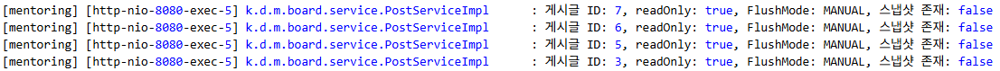

- (2) readOnly = false인 경우

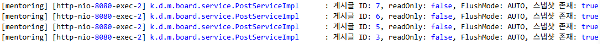

### (6) 결론

실제 데이터로 정량적인 성능 비교를 해보진 못했지만 이론적 원리를 통해 더티 체킹을 생략하고 스냅샷을 저장하지 않기에 조회 성능이 개선될 수 있음을 확인했다.