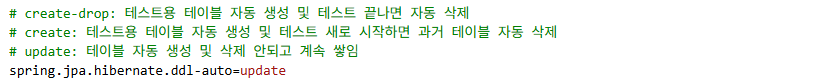
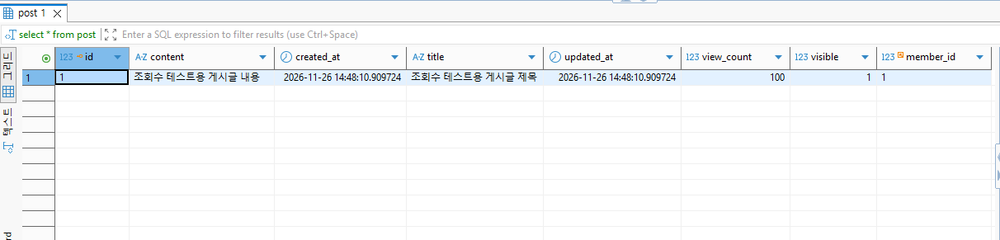
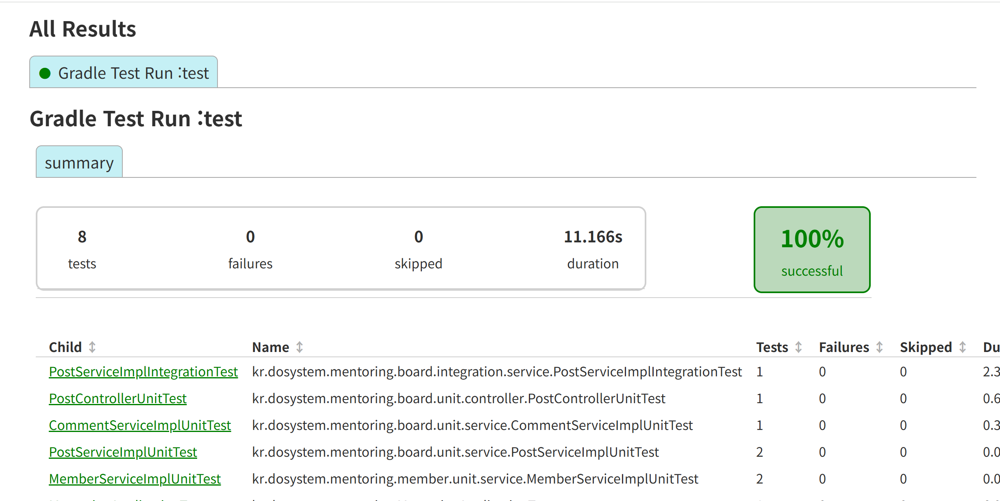
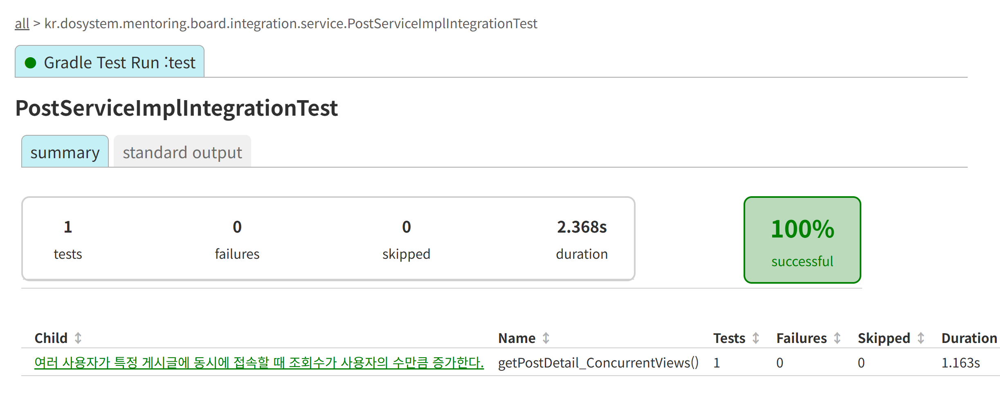

## 1. 인트로

안녕하세요 이호균입니다. 이번 발표에서는 여러 사용자가 동시에 게시글 조회 시 조회수가 정확하게 증가 되는지에 대한 테스트 과정과 결과를 설명하겠습니다.

## 2. 주제 선정 이유

기존에 Post 엔티티에 정의한 조회수 증가 메서드는 메모리에서 연산을 수행한 후 DB에 반영하는 방식이었다.

- 기존 메서드
```java
// 조회수 증가
public void increaseView() {
    this.viewCount++;
}
```


따라서 만약 여러 사용자가 동시에 게시글을 조회하면 똑같은 viewCount 값을 전달받아 각각 1 증가시킨 후 DB에 저장하게 되어 조회수가 누락될 수 있는 문제가 있었다.

| 사람 | 전달받은 viewCount 값 | 증가시킨 값 | DB에 저장할 값 |
|---|---|---|---|
| A | 100 | 100 -> 101 | 101 |
| B | 100 | 100 -> 101 | 101 |
| C | 100 | 100 -> 101 | 101 |

**올바른 조회수: 103**

**실제 조회수: 101**

**=> 2의 조회수가 사라짐**

이를 해결하기 위해 Repository 쿼리 메서드를 사용하여 viewCount = viewCount + 1 연산을 하나의 update 쿼리에서 실행하도록 수정했다. 이때 db에서 해당 행에 대한 Lock이 적용되어 현재 트랜잭션이 commit되기 전까지 다른 트랜잭션의 update 쿼리가 대기하게 된다. 이후 최신 조회수 값을 기준으로 연산을 수행하기 때문에 조회수가 누락되지 않는다.

- 수정된 메서드
```java
@Modifying
@Query("UPDATE Post p SET p.viewCount = p.viewCount + 1 WHERE (p.id = :postId) AND (p.visible = true OR p.member.id = :memberId)")
int increaseViewCount(@Param("postId") Long postId, @Param("memberId") Long memberId);
```


따라서 새롭게 작성한 쿼리 메서드가 정상적으로 조회수 증가를 수행하는지에 대한 여부를 확인할 필요가 있다고 생각되어 이 주제를 선택했다.

## 3. 통합 테스트로 진행한 이유

단위 테스트에서는 보통 Mockito 기반의 테스트로 진행하여 가짜 Repository 객체를 사용하기 때문에 실제 DB에서 조회수 증가 쿼리가 실행되는지 확인할 수 없다.

따라서 실제 DB와 Repository에 접근하는 통합 테스트로 진행했다.

## 4. 테스트 과정

테스트는 Given – When – Then 과정으로 진행했다.

| 단계 | 설명 |
|---|---|
| Given | 어떤 조건에서 |
| When | 어떤 기능을 실행하면 |
| Then | 어떤 결과가 나와야 하는가 |

### (1) Given: 테스트 게시글 생성


```java
@Test
@DisplayName("동일한 회원의 100개 동시 조회 요청에서 조회수가 정확히 증가한다.")
void getPostDetail_ConcurrentViews() throws Exception {

    // 동시 접속할 사용자 수(스레드 수) 설정
    int threadCount = 100;

    // 테스트마다 중복되지 않을 회원 정보 생성. ex) 아이디: test550e84
    String suffix = UUID.randomUUID().toString().substring(0, 6);

    // 테스트용 회원 1개 생성 및 실제 DB에 저장 (게시글 생성을 위한 목적)
    Member member = new Member("test" + suffix, BCrypt.hashpw("test1234!", BCrypt.gensalt()), "테스트" + suffix, "test" + suffix + "@gmail.com");
    member = memberRepository.save(member);

    // 테스트용 게시글 1개 생성 및 실제 DB에 저장
    Post post = new Post(member, "조회수 테스트용 게시글 제목", "조회수 테스트용 게시글 내용");
    post = postRepository.save(post);

    // 테스트에 사용할 pk 및 최초 조회수 저장
    memberId = member.getId();
    postId = post.getId();
    int beforeViewCount = post.getViewCount();
}
```


Given 단계에선 회원 1명과 게시글 1개를 생성 후 실제 DB에 저장하여 테스트 환경을 구성했다. 또한 100명의 사용자가 동일한 게시글에 동시 접근하는 상황을 가정하고 100개의 스레드를 생성했다.

### (2) When: 100개 스레드에서 1개의 게시글에 동시 접속


```java
// 모든 작업 스레드의 준비 완료 여부를 확인하는 래치
CountDownLatch ready = new CountDownLatch(threadCount);

// 모든 작업 스레드의 동시 출발 신호를 위한 래치
CountDownLatch start = new CountDownLatch(1);

// Executors.newFixedThreadPool(100): 최대 100개 크기의 고정 크기 스레드풀 생성
try (ExecutorService executor = Executors.newFixedThreadPool(threadCount)) {

    // ------------------------------ 메인 스레드 실행 --------------------------------

    for (int i = 0; i < threadCount; i++) {

        // executor.submit(): 메인 스레드가 {...} 내부의 작업을 스레드 풀에 제출(submit)하고 Future 객체 반환
        futures.add(executor.submit(() -> {

            // ------------------------------ 작업 스레드 실행 --------------------------------

            // 작업 스레드가 ready 카운트를 1 감소
            ready.countDown();

            // 작업 스레드가 출발 신호를 받을 때까지 대기
            start.await();

            // 출발 신호를 받으면 실제 서비스 메서드 실행
            postService.getPostDetail(postId, memberId);
            return null;

            // ------------------------------ 작업 스레드 실행 끝 --------------------------------
        }));
    }

    // ------------------------------ 메인 스레드 실행 --------------------------------

    // 아직 실행 안된 ready.countDown()이 있을 수도 있으니 대기
    ready.await();

    // 100개 스레드에 출발 신호를 보냄
    start.countDown();
    }

// ------------------------------ 메인 스레드 실행 --------------------------------

// 예외 원인 확인용
for (Future<?> future : futures) {
    future.get();
}
```

이때 ready와 start라는 2개의 CountDownLatch를 사용했다. ready는 모든 스레드가 준비될 때까지 기다리는 역할을 하고 start를 통해 대기 중인 100개 스레드에 출발 신호를 전달했다.

### (3) Then: 게시글의 조회수가 100이 찍혀있어야 한다.


```java
Post updatedPost = postRepository.findById(postId).orElseThrow();

// 조회 전 조회수(0) + 스레드 수(100) = 조회 후 조회수(100)
assertEquals(beforeViewCount + threadCount, updatedPost.getViewCount());
```


Repository를 통해 게시글을 조회해보고 최신 viewCount 값을 받아온 후 assertEquals를 통해 과거의 viewCount와 비교하여 검증했다.

## 5. 테스트 실행 결과

테스트 실행: gradlew.bat test

테스트 결과 보고서 확인: start .\build\reports\tests\test\index.html

### (1) DB 조회수 확인

테스트 db의 테이블을 유지하기 위해 application-test.properties의 spring.jpa.hibernate.ddl-auto 값을 update로 설정했다. 

다만 현재는 @AfterEach를 통해 테스트 종료 후 생성한 데이터를 삭제하도록 구현했기 때문에, 테스트 결과는 조회수를 확인하기 위해 @AfterEach를 주석 처리하고 진행했다.





결과: 실제 조회수 값이 100으로 찍혀있는것을 확인할 수 있다.

### (2) Gradle 테스트 결과 보고서



결과: test 전체에서 총 8개의 테스트가 모두 통과한 것을 확인할 수 있다.



결과: 조회수 동시성 통합 테스트도 성공한 것으로 표시된다.

## 6. 코드 리뷰 피드백 개선 부분

### (1) ready 래치 추가

기존에는 start 래치만 있었지만 새롭게 ready 래치를 추가하여 100개의 스레드가 준비를 완벽하게 마친 후 출발 신호를 전달하도록 변경했다.

- 기존코드


```java
CountDownLatch start = new CountDownLatch(1); // start만 사용

for (int i = 0; i < threadCount; i++) {
    futures.add(executor.submit(() -> {
        start.await();
        postService.getPostDetail(postId, memberId);
        return null;
    }));
}

start.countDown();
```


- 바뀐코드


```java
CountDownLatch ready = new CountDownLatch(threadCount); // ready 추가
CountDownLatch start = new CountDownLatch(1);

for (int i = 0; i < threadCount; i++) {
    futures.add(executor.submit(() -> {
        ready.countDown();
        start.await();
        postService.getPostDetail(postId, memberId);
        return null;
    }));
}

ready.await();
start.countDown();
```


### (2) future.get() 추가

기존엔 각 작업 스레드에서 getPostDetail()이 실행 중에 예외가 발생하더라도 예외의 원인이 전달되지 않아 이유를 알 수 없는 실패가 발생할 수 있었다. 따라서 future.get()을 통해 예외 발생 시 이를 테스트 메서드에 전달하도록 개선함.


```java
// 추가
for (Future<?> future : futures) {
    future.get();
}

Post updatedPost = postRepository.findById(postId).orElseThrow();

assertEquals(beforeViewCount + threadCount, updatedPost.getViewCount());
```


### (3) 테스트 메서드 종료 후 데이터 삭제

그 전까진 테스트 종료시에도 과거의 데이터가 쌓이게 되어 @AfterEach를 사용하여 데이터가 자동으로 삭제되게 구현함.


```java
// @AfterEach: 각 테스트 메서드(@Test)가 실행된 후 @AfterEach 어노테이션이 붙은 메서드가 자동으로 호출됨
@AfterEach
void tearDown() {

    // 게시글 먼저 삭제
    if (postId != null) {
        postRepository.deleteById(postId);
    }

    // 회원 나중에 삭제
    if (memberId != null) {
        memberRepository.deleteById(memberId);
    }
}
```