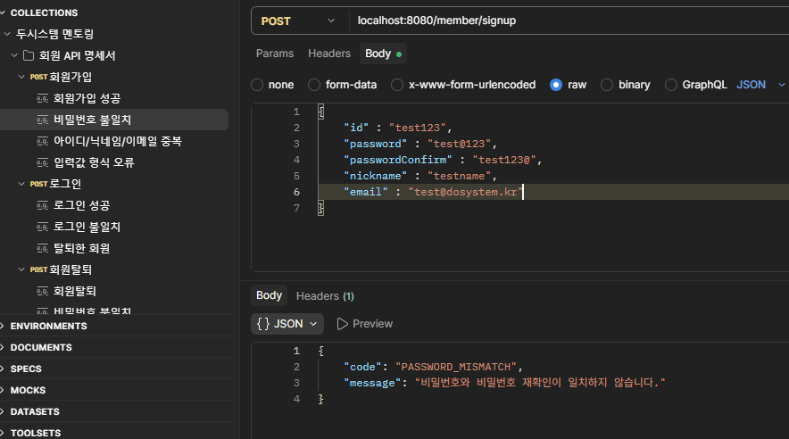
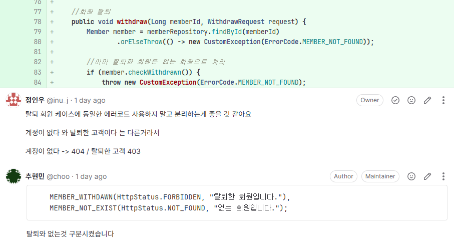
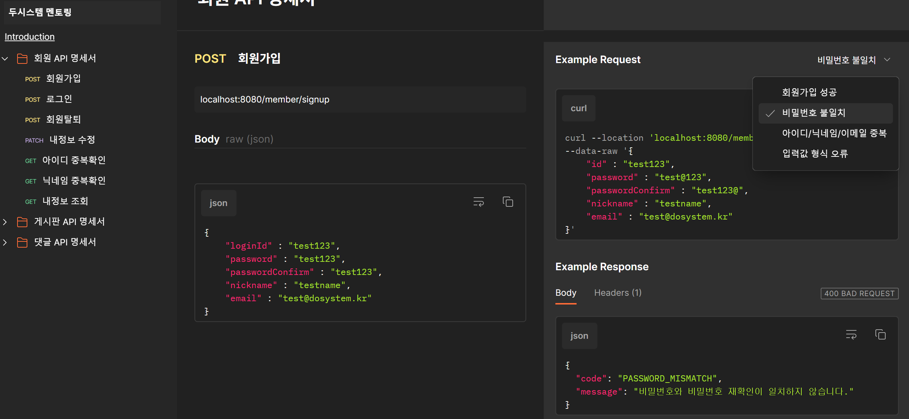
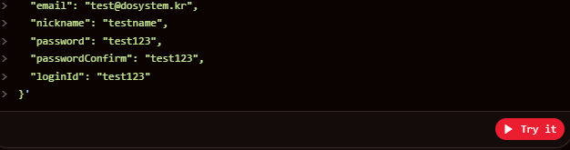
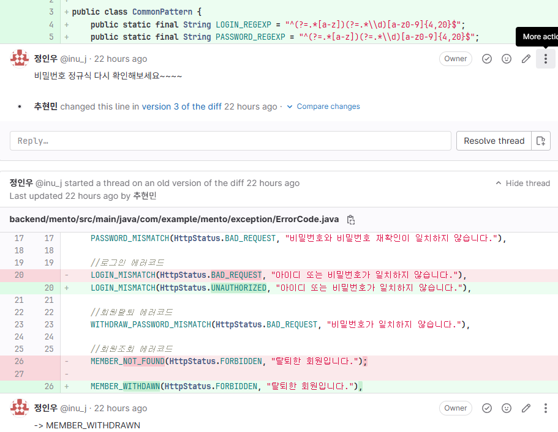

멘토링 1주차와 2주차에 명시된 Postman 사용과 HTTP 요청과 응답 설계에 대해 알아보고 웹 페이지 문서로 테스트와 명세서를 한 곳에서 봅니다.

## 회원가입 API 하나에도 응답은 여러 가지

회원가입 예시로 본 여러 가지 에러 응답

| 경우 | 상태 | code | message |
|---|---|---|---|
| 성공 | 201 | | `{"id": 1}` |
| 아이디 형식 오류 | 400 | `INVALID_INPUT` | 아이디는 숫자와 영문을 포함한 4~20자리입니다. |
| 비밀번호 재확인 불일치 | 400 | `PASSWORD_MISMATCH` | 비밀번호와 비밀번호 재확인이 일치하지 않습니다. |
| 아이디 중복 | 409 | `DUPLICATE_ID` | 이미 사용중인 아이디 입니다. |
| 닉네임 중복 | 409 | `DUPLICATE_NICKNAME` | 이미 사용중인 닉네임 입니다. |
| 이메일 중복 | 409 | `DUPLICATE_EMAIL` | 이미 사용중인 이메일 입니다. |

## Postman으로 경우별 예시 저장하기

Save as Example을 통해 요청 상황별 예시를 정리해 필요한 에러 메세지를 정리한다. 



## HTTP 요청과 응답 구조

| 요청 메서드 | 사용 목적 | 응답 상태코드 | 사용 목적 |
|---|---|---|---|
| GET | 데이터 조회 | 200 OK | 요청 성공 |
| POST | 데이터 생성 | 201 Created | 생성 성공 |
| PUT | 데이터 전체 수정 | 204 No Content | 성공, 본문 없음 |
| PATCH | 데이터 부분 수정 | 400 Bad Request | 잘못된 요청 |
| DELETE | 데이터 삭제 | 401 Unauthorized | 인증 실패 |
| | | 403 Forbidden | 권한 없음 |
| | | 404 Not Found | 찾을 수 없음 |
| | | 409 Conflict | 중복·충돌 |
| | | 500 Internal Server Error | 서버 오류 |

| 요청 헤더 | 사용 목적 | 응답 헤더 | 사용 목적 |
|---|---|---|---|
| Content-Type | 보내는 데이터 형식 | Content-Type | 응답 데이터 형식 |
| Authorization | 인증 정보(토큰) | Cache-Control | 캐시 저장 설정 |
| User-Agent | 요청한 클라이언트 정보 | Set-Cookie | 클라이언트에 쿠키 저장 요청 |
| | | Location | 생성된 자원의 주소 |

->과제에서 상태코드 틀린 예시


## 웹 문서로 공개하기

Postman에는 기본 웹문서 배포와 Fern을 활용한 배포가 있다.


-->

Fern으로 웹페이지를 배포할 경우 Try it 버튼을 통해 명세와 직접 테스트 요청을 같이 볼 수 있다.


## Notion, Swagger와 비교

| 도구 | 여러 실패 경우를 보여 주는 방식 | 한계 |
|---|---|---|
| Notion·Markdown 표 | 표로 직접 적음 | 실제 응답과 맞는지 알 수 없고, 코드가 바뀌어도 그대로 남음. 실행해 볼 수 없음 |
| Swagger | 코드에서 자동 생성, 상태 코드별 응답 | 기본은 상태 코드당 예시 하나. 같은 409를 여러 개로 나누려면 어노테이션이 많아짐. 코드가 있어야 문서가 생김 |
| Postman | 경우마다 예시 저장, 요청과 응답이 한 쌍 | 코드와 따로 관리하므로 바뀌면 다시 저장해야 함 |


## 정리 및 회고

멘토링과정에서 요구사항들을 정리해 만든 API 명세서를 각 기능에 맞는 에러처리를 미리 설계하면 공통 에러 처리와 변경사항을 반영하기 쉬웠다.
```java
public enum ErrorCode {

    //회원가입 에러코드
    INVALID_INPUT(HttpStatus.BAD_REQUEST, "입력값이 올바르지 않습니다." ),
    DUPLICATE_ID(HttpStatus.CONFLICT, "이미 사용중인 아이디 입니다."),
    DUPLICATE_NICKNAME(HttpStatus.CONFLICT, "이미 사용중인 닉네임 입니다."),
    DUPLICATE_EMAIL(HttpStatus.CONFLICT, "이미 사용중인 이메일 입니다."),
    PASSWORD_MISMATCH(HttpStatus.BAD_REQUEST, "비밀번호와 비밀번호 재확인이 일치하지 않습니다."),

    //로그인 에러코드
    LOGIN_MISMATCH(HttpStatus.UNAUTHORIZED, "아이디 또는 비밀번호가 일치하지 않습니다."),

    //회원탈퇴 에러코드
    WITHDRAW_PASSWORD_MISMATCH(HttpStatus.BAD_REQUEST, "비밀번호가 일치하지 않습니다."),

    //회원조회 에러코드
    MEMBER_WITHDRAWN(HttpStatus.FORBIDDEN, "탈퇴한 회원입니다."),
    MEMBER_NOT_EXIST(HttpStatus.NOT_FOUND, "없는 회원입니다.");

    private final HttpStatus httpStatus;
    private final String message;
}
```


기능동작만 테스트하고 커밋하는 경우가 많아 입력형식 정규식 변경이나 복사한 코드들로 인해 다른 에러코드를 응답하는 경우를 거르지 못하고 
그대로 커밋한 경우가 있었다. 

->에러 예시들도 코드를 변경한 이후에 테스트가 필요하다.

